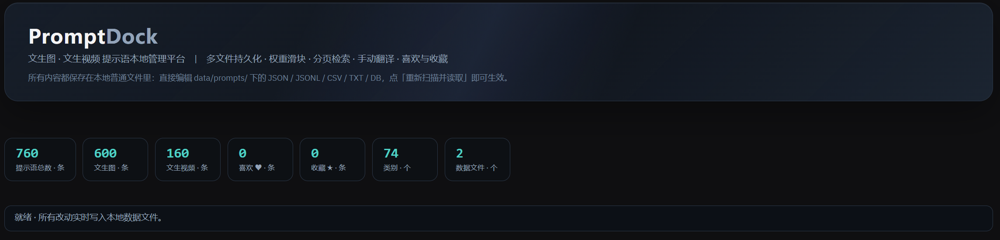
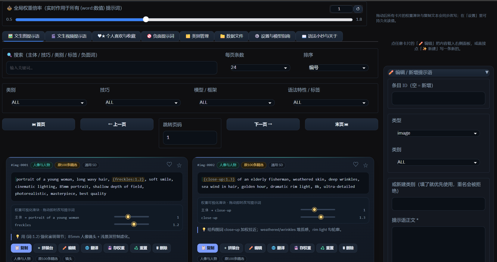

<div align="center">

# 🧭 PromptDock

**文生图 / 文生视频提示语本地工作台**

[](https://www.python.org/)
[](https://www.gradio.app/)
[](LICENSE)
[]()
[]()

</div>

---

## 项目简介

**PromptDock** 是一个用 Python + Gradio 写成的**本地提示语管理平台**，把文生图与文生视频的提示词、技巧注解、权重写法、负面词、模型规范统一收进一个可搜索、可编辑、可收藏的暗色工作台。

它不依赖云服务、不注册账号、不上传数据：所有内容就是 `data/prompts/` 下的普通 **JSON / JSONL / CSV / TXT / SQLite** 文件，可以直接用任何编辑器修改、拆分成多个文件、放进 Git 做版本管理；在界面里点一次「重新扫描并读取」就生效。内置 **760 条提示语**（600 条文生图 · 60 类，160 条文生视频 · 16 类），附带权重可视化滑块、分页检索、免费在线翻译（手动触发）、喜欢与收藏、拼装台、类别管理、二次确认删除，以及 10 个主流模型 / 框架的撰写规范。

**为什么叫 PromptDock**：`Prompt` + `Dock`（停靠坞 / 工作台）——让散落在各处、各模型、各笔记里的提示词，都停靠到同一个本地工作台里。

---

## 目录

- [🧭 PromptDock](#-promptdock)
  - [项目简介](#项目简介)
  - [目录](#目录)
  - [✨ 核心特性](#-核心特性)
  - [🚀 快速开始](#-快速开始)
  - [🖥️ 界面一览](#️-界面一览)
  - [🧮 权重滑块与多模型规范](#-权重滑块与多模型规范)
  - [📁 数据文件：怎么写、怎么拆](#-数据文件怎么写怎么拆)
  - [⚙️ 配置说明](#️-配置说明)
  - [✅ 需求对照](#-需求对照)
  - [🗂️ 目录结构](#️-目录结构)
  - [🧪 自检](#-自检)
  - [❓ 常见问题](#-常见问题)
  - [🤝 贡献与路线图](#-贡献与路线图)
  - [🙏 致谢](#-致谢)
  - [📄 许可](#-许可)

---

## ✨ 核心特性

| | 特性 | 说明 |
|---|---|---|
| 🗄️ | **本地优先 · 多文件持久化** | 启动时递归扫描 `data/prompts/`；支持 5 种格式；可拆成任意多个文件；外部编辑器改完点「重新扫描并读取」即生效 |
| ✍️ | **完整增删改查** | 文生图 / 文生视频都能新增、编辑、删除、复制；字段含正文、负面词、技巧、标签、模型、语法、运镜、时长、帧率、运动强度、写入哪个文件 |
| 🎚️ | **权重可视化滑块** | `(word:1.2)`、`word::2`、`<lora:x:0.8>`、`[from:to:0.5]` 自动解析成独立滑块，拖动即时改写；另有全局倍率与主体前置权重 |
| 🧠 | **6 种权重语法画像** | `sd` / `flux` / `mj` / `comfy` / `wan` / `custom`，可全局切换，也可在单条用 `syntax` 字段覆盖；自定义模板支持 `{w}` `{v}` |
| 📚 | **10 个模型撰写指南** | SD1.5、SDXL、FLUX/SD3、Pony、Midjourney、国产中文模型、Sora 2、Kling/Runway、Wan/HunyuanVideo/CogVideoX、AnimateDiff/Pika/Luma，可一键套用示例 |
| 📄 | **真分页** | 每页 8 / 12 / 24 / 48 / 96 条；首页 / 上一页 / 下一页 / 末页 / 输入页码；启动时 600 条自动分 50 页 |
| 🌐 | **翻译（手动触发）** | Google 免费接口 → MyMemory 自动回退 → 可填 LibreTranslate；长文本分块；译文可编辑、复制、替换正文；**绝不后台自动上传** |
| ♥★ | **喜欢 + 收藏** | 两个独立标记，状态写回本地文件；独立页面筛选「全部 / 仅喜欢 / 仅收藏」，支持手动刷新、取消标记、编辑、分页 |
| 🗂️ | **类别管理** | 新增 / 改名重名会提示并拒绝；改名同步更新所有条目；删除类别连带删除其下提示语并二次确认 |
| 🛡️ | **删除二次确认** | 删条目 / 删类别 / 删数据文件 / 清空拼装台全部需确认，可按 `Esc` 取消 |
| 🧩 | **拼装台与导出** | 多条提示词用 `, ` / `AND` / `BREAK` / 换行拼接；当前页或全部筛选结果导出 `.txt`；支持当前页批量入台 |
| 🎨 | **华丽暗色界面** | 玻璃拟态顶栏、渐变统计卡、暗色提示词卡片、金色权重高亮、响应式布局；沿用离线 HTML 卡片库的视觉语言 |

---

## 🚀 快速开始

**环境**：Python 3.9+（开发验证于 3.12）、一个能跑 Gradio 的桌面 / 工作站环境。除 Gradio 外**零第三方依赖**。

```bash
git clone https://github.com/GongHuilin-DL/promptdock.git
cd promptdock

python -m venv .venv
source .venv/bin/activate          # Windows: .venv\Scripts\activate

pip install -r requirements.txt
python app.py                      # → http://127.0.0.1:7860，自动打开浏览器
```

也可以直接下载 Release / zip 解压后运行，无需 clone。

常用参数：

```bash
python app.py --port 7861 --no-browser         # 换端口 / 不自动开浏览器
python app.py --data-dir /path/to/my_data      # 指向另一套数据目录
python app.py --host 0.0.0.0                  # 局域网内访问
python app.py --share                          # 临时公网分享链接
```

启动后终端会打印：

```
[PromptDock] 数据目录：/…/data
[PromptDock] 已加载 760 条提示语 / 2 个数据文件 / 74 个类别
```

> **开箱即用**：仓库自带 600 条文生图 + 160 条文生视频提示语，覆盖 76 个类别。`reference/SD提示词卡片库.html` 是上一版单文件离线卡片库，可双击直接打开对照。

---

## 🖥️ 界面一览
<div></div>
<div></div>

顶部是统计卡（总数 / 文生图 / 文生视频 / 喜欢 / 收藏 / 类别 / 数据文件）、操作反馈条、**全局权重倍率**滑块与二次确认条；左侧 8 个选项卡，右侧是常驻工具侧栏。

| 选项卡 | 用途 |
|---|---|
| 🖼️ 文生图提示语 | 搜索、类别 / 技巧 / 模型 / 标签筛选、排序、分页、卡片操作 |
| 🎬 文生视频提示语 | 同上，卡片额外显示运镜、时长、帧率、运动强度与负向词 |
| ♥★ 个人喜欢与收藏 | 只看喜欢 / 收藏，可切换「仅喜欢」「仅收藏」，支持手动刷新与取消标记 |
| 🚫 负面提示词 | 三套可编辑负面词（完整 / 写实 / 动漫）+ 视频负向词思路，一键复制、填入编辑面板 |
| 🗂️ 类别管理 | 新增 / 改名 / 删除类别，重名拒绝，删除连带清理 |
| 📁 数据文件 | 扫描、读取、新建、编辑原始内容、删除文件、打开文件管理器 |
| ⚙️ 设置与模型指南 | 每页条数、权重语法、翻译服务、自定义模板 + 10 个模型规范 |
| 📖 语法小抄与关于 | 权重语法表、模型差异、使用说明 |

**右侧常驻侧栏**：选中详情 → 编辑 / 新增面板 → 翻译 → 拼装台 → 导出文件。

> 想补截图？把图片放到 `docs/screenshot.png`，然后在 README 里加一行 `` 即可（仓库暂不含截图，避免占位图误导）。

---

## 🧮 权重滑块与多模型规范

卡片会把提示词里可调权重的片段解析成独立滑块，拖动即改写，**复制 / 加拼装台 / 存权重**用的都是改写后的文本。

| 语法画像 | 适配对象 | 写法 |
|---|---|---|
| `sd` | SD 1.5 / WebUI / ComfyUI | `(word:1.2)`、`(word)`≈1.1、`[word]`≈0.9 |
| `comfy` | ComfyUI 进阶 | `(A:B:0.6)` 分步混合、`AND` / `BREAK` |
| `flux` | FLUX.1 / SD3 / Sora / 国产中文模型 | 不解析数值权重，用完整自然语言长句 |
| `wan` | Wan / HunyuanVideo / CogVideoX | 中文长句 + 运镜 + 时间连续性 |
| `mj` | Midjourney v6 / v7 | `word::2`、`--ar 16:9`、`--no` |
| `custom` | 任意框架 | 自定义模板，如 `(({w}:{v}))` |

**全局倍率**在页面顶部，作用于所有 `(word:数值)`；**主体前置权重**滑块可临时给主体短语加权。单条提示语可用 `"syntax": "flux"` 覆盖全局设置。

「设置与模型指南」里每个模型都给了推荐结构、负面词策略、关键技巧与可一键套用的示例。视频模型的核心原则是：**一个镜头 + 一个连续动作 + 一种运镜**，别一次写多个动作。

---

## 📁 数据文件：怎么写、怎么拆

`data/prompts/` 下的**每个文件都是一个独立提示语库**，程序递归扫描。可直接用记事本 / VS Code 改，也可以在界面「📁 数据文件」里编辑原始内容并保存。

**JSON**（推荐，可带元信息）

```json
{
  "description": "我的人像私藏",
  "default_kind": "image",
  "items": [
    {
      "id": "my-001",
      "kind": "image",
      "category": "人像与人物",
      "prompt": "portrait of a woman, (freckles:1.2), 85mm, golden hour",
      "negative": "bad hands, watermark",
      "tip": "权重强化 + 人像镜头",
      "tech": "权重强化",
      "tags": ["镜头", "括号语法"],
      "model": "SDXL",
      "syntax": "sd",
      "subject": "portrait of a woman",
      "like": true,
      "favorite": false
    }
  ]
}
```

**JSONL**（适合超大数据量，逐行追加）

```jsonl
# 以 # 开头是注释，写回时会保留
{"prompt":"slow dolly-in over a misty lake","kind":"video","category":"运镜与镜头运动"}
{"prompt":"a cat sleeping on books","category":"治愈系Lo-fi","favorite":true}
```

**TXT**（最轻量）

```text
# 每行一条提示语 ||| 类别 ||| 技巧说明
a neon alley in rain, cinematic ||| 建筑与城市 ||| 雨夜反射
slow pan over lavender field ||| 运镜与镜头运动 ||| 运镜词独立书写
```

**CSV**：表头列名即字段名（`prompt` 必填），`tags` 用逗号分隔字符串。
**SQLite `.db`**：表 `prompts(id TEXT, payload TEXT)`，`payload` 为条目 JSON。

> 除 `prompt` 外所有字段都可省略，缺失自动补默认值；**自定义字段会被原样保留**，写回时不丢。
> 不写 `id` 时按内容生成稳定 id（调整顺序不丢收藏，但改正文会变），所以自建条目建议手动写 `id`。

**典型工作流**

1. 编辑器里改文件，或新增一个 `03_我的私藏.jsonl`；
2. 界面「📁 数据文件」→「🔄 重新扫描文件列表」（发现新文件）/「📥 重新扫描并读取全部数据」（应用改动）；
3. 新内容立刻出现在三个列表页，喜欢与收藏状态保持不变。

大数据量建议按项目 / 类别拆成多个文件；`data/exports/` 是导出目录，不会被扫描。

---

## ⚙️ 配置说明

`data/config/settings.json`（同样是普通 JSON，可手改）：

| 键 | 默认 | 说明 |
|---|---|---|
| `page_size` | `24` | 启动时每页条数 |
| `global_weight` | `1.0` | 全局权重倍率 |
| `syntax_profile` | `sd` | 默认权重语法画像 |
| `custom_tpl` | `({w}:{v})` | 自定义模板，必须含 `{w}` 与 `{v}` |
| `default_target_file` | `99_自定义提示语.json` | 新增条目默认写入的文件 |
| `translate.provider` | `gtx` | `gtx` / `mymemory` / `libre` / `off` |
| `translate.target` | `zh-CN` | 目标语言 |
| `translate.timeout` | `8` | 超时秒数 |
| `translate.custom_endpoint` | `""` | 自建 / 公共 LibreTranslate 端点 |
| `translate.enabled` | `true` | 关闭后翻译按钮只给提示，不发请求 |
| `negative_presets` | 3 套 | 完整 / 写实 / 动漫负面词，界面可编辑保存 |

`data/config/categories.json` 是类别表，`data/config/model_guides.json` 是模型撰写规范（可自行扩充）。

---

## ✅ 需求对照

| # | 需求 | 实现 |
|---|---|---|
| 1 | 本地持久化、启动加载、可直接编辑文件、支持多文件 | 5 种格式递归扫描；界面 + 外部编辑器双通道；重新扫描 / 读取按钮 |
| 2 | 自定义提示语、增删改、词权重、主流模型撰写技巧 | 全字段编辑；6 种语法画像 + 10 个模型指南 + 滑块 + 全局倍率 |
| 3 | 搜索结果多、可设每页条数、上一页 / 下一页 | 5 档每页条数 + 首页 / 上页 / 下页 / 末页 / 页码跳转 |
| 4 | 启动时词条数超过设置值要分页 | 默认 24 条 / 页，760 条自动分页 |
| 5 | 整合免费在线翻译、手动触发 | gtx → MyMemory 回退 → LibreTranslate；仅点击时请求 |
| 6 | 编辑 / 增加 / 删除数据库文件 + 手动重扫 | 新建、原始内容编辑保存、删除、扫描、读取、打开目录 |
| 7 | 喜欢与收藏页面、手动刷新、取消、编辑、分页 | 独立双标记 + 独立页面 + 刷新 + 与其它页一致的分页编辑 |
| 8 | 类别增改删、重名拒绝、删类别二次确认 | 全局唯一校验 + 改名同步 + 连带删除确认 |
| 9 | 删除行为二次确认 | 条目 / 类别 / 文件 / 拼装台四类删除均需确认，`Esc` 可取消 |
| — | 保留 HTML 版功能与框架 | 600 条原始提示语、筛选、复制、权重滑块、负面词、收藏、拼装台、导出、暗色卡片风格全部保留 |

---

## 🗂️ 目录结构

```
promptdock/
├── app.py                       # Gradio 主程序（入口）
├── core/
│   ├── models.py                # 宽松 schema 归一化
│   ├── storage.py               # 多文件扫描 / 读写 / 类别 / 设置
│   ├── syntax.py                # 权重语法画像 + 模型撰写指南
│   ├── translate.py             # 免费翻译（gtx / MyMemory / LibreTranslate）
│   └── cards.py                 # 暗色卡片渲染 + 前端交互脚本
├── assets/theme.css             # 暗色玻璃拟态主题
├── data/
│   ├── prompts/                 # ← 提示语库（可随意增删改文件）
│   │   ├── 01_文生图_内置精选.json     600 条
│   │   ├── 02_文生视频_内置精选.json   160 条
│   │   └── README.md                    格式说明
│   ├── config/                  # settings / categories / model_guides
│   └── exports/                 # 导出目录（自动创建，不扫描、不入库）
├── reference/SD提示词卡片库.html  # 上一版离线单文件卡片库
├── tools/
│   ├── build_seed_data.py       # 重建初始数据（谨慎：会覆盖内置数据）
│   ├── run_checks.py            # 逻辑自检（60+ 项）
│   └── http_check.py            # 真实启动服务自检
├── requirements.txt
├── .gitignore
├── LICENSE
└── README.md
```

---

## 🧪 自检

```bash
python tools/run_checks.py     # 存储层 CRUD / 权重语法 / 卡片渲染 / 界面函数
python tools/http_check.py     # 启动真实服务，检查页面与事件 API
```

`tools/build_seed_data.py` 只在需要重建初始数据时运行，平时**不要**重跑。

---

## ❓ 常见问题

**改了数据文件但界面没变？**
点「📁 数据文件 → 📥 重新扫描并读取全部数据」。只新建了文件则先点「🔄 重新扫描文件列表」。

**翻译一直失败？**
需要能访问外网。可在设置里切到 `mymemory` 或填可用的 LibreTranslate 端点；完全离线时把翻译关掉，其它功能不受影响。

**FLUX / Sora 不该出现权重括号？**
把默认画像切到 `flux` / `wan`，或单条设 `"syntax": "flux"`，卡片就不再解析数值权重滑块。

**中文文件名在 Git / 解压后乱码？**
仓库内文件名均为 UTF-8。若你的环境有问题，可把两个内置 JSON 重命名为 ASCII（如 `01_image.json`、`02_video.json`），内容不变，扫描器按后缀识别。

**误删了怎么办？**
所有删除都有二次确认；数据文件就是普通文本，建议定期备份 `data/` 整个目录，或直接把 `data/prompts/` 纳入 Git 版本管理。

**端口被占用？**
`python app.py --port 7861`。

---

## 🤝 贡献与路线图

欢迎 Issue / PR，尤其欢迎：

- 补充更多模型 / 推理框架的撰写规范（`data/config/model_guides.json`）
- 新增权重语法画像（在 `core/syntax.py` 的 `PROFILES` 里加一项即可）
- 更多格式支持（YAML / TOML / Parquet）
- 界面截图、国际化、可访问性改进
- 提示语数据扩充（直接往 `data/prompts/` 加文件即可，无需改代码）

可能的后续方向：标签批量管理、提示语版本 diff、生成参数（seed / steps / cfg）记录、与本地 SD WebUI / ComfyUI 一键发送、导入导出为 CSV/JSON 备份包。

提交前请跑 `python tools/run_checks.py`。

---

## 🙏 致谢

- [Gradio](https://www.gradio.app/) — 界面框架
- Google 免费翻译公开接口、[MyMemory](https://mymemory.translated.net/)、[LibreTranslate](https://libretranslate.com/) — 手动翻译能力（本项目不 affiliated，接口可用性以各服务方为准）
- Stable Diffusion / ComfyUI / FLUX / Midjourney / Kling / Sora / Wan 等社区 — 提示词写法与技巧的灵感来源

---

## 📄 许可

[MIT](LICENSE) © 2026 PromptDock Contributors

> 默认采用 MIT（宽松、便于分享与二次开发）。若你需要 Apache-2.0 / GPL-3.0 或添加额外声明，替换 `LICENSE` 并同步修改 README 顶部的 License badge 即可。

---

<div align="center">

**如果它帮你把散落的提示词收拢到了一起，欢迎点个 ⭐ Star。**

</div>
